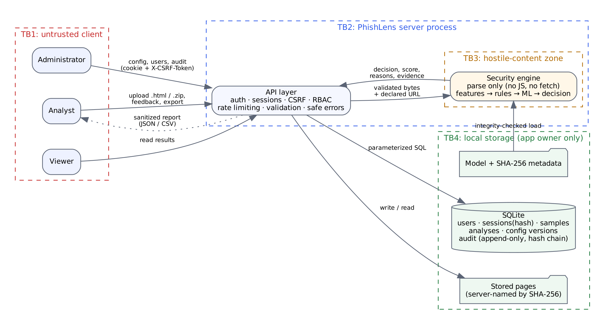
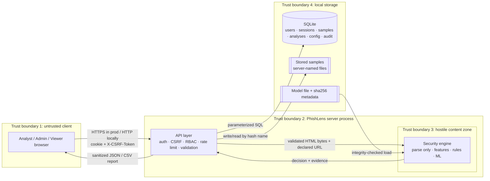

# Architecture

## Layers

| Layer | Folder | Responsibility |
|---|---|---|
| 1. Presentation | `frontend/` | Validated input forms, explainable result view, history, admin. No security logic. |
| 2. API / service | `app/main.py`, `app/routers/`, `app/security/` | Authentication, sessions, CSRF, RBAC, rate limiting, business rules, safe errors |
| 3. Security engine | `engine/` | Input validation, feature extraction, rule engine, ML model, decision pipeline (pure functions, unit-tested) |
| 4. Repository | `app/db.py`, `app/audit.py` | SQLite schema, parameterized queries, versioned config, append-only hash-chained audit log |
| 5. Test fixtures | `fixtures/`, `tests/` | Safe hand-written pages, synthetic dataset generator, pytest suite |

## Data-flow diagram with trust boundaries



Source: `docs/diagrams/dfd.dot` (Graphviz). Same diagram as Mermaid:



## Analysis sequence

1. **Import & labeling (FR-1)** — `POST /api/samples` or `/api/samples/import`: auth + permission + CSRF,
   rate limit, file type/size/content checks, optional label + declared URL validated, duplicate detection by SHA-256.
2. **Feature extraction (FR-2)** — `engine/features.py`: 53 numeric URL/DOM/text/visual-risk features (served model) + short evidence snippets.
3. **Baseline rules (FR-3)** — `engine/rules.py`: 26 named rules, noisy-OR score, admin can disable rules.
4. **ML classifier (FR-4)** — `engine/model.py`: Random forest chosen by 5-fold CV (logistic regression also supported); exact per-feature contributions (path decomposition).
5. **Explanation (FR-5)** — final score = `ml_weight·ML + (1−ml_weight)·rules` (calibrated: 0.8; suspicious ≥ 0.42, phishing ≥ 0.54), thresholds → decision, severity,
   recommended action, fired rules with evidence, top model contributions, all versions stored.
6. **Feedback & export (FR-6)** — analyst marks correct / FP / FN; sanitized JSON/CSV report; history CSV.

## Data model

See `SCHEMA` in `app/db.py`. Key points: IDs are server-generated UUIDs; `samples.sha256` is unique;
each `analyses` row stores `config_version`, `model_version`, `ruleset_version` and the full result JSON so
any decision can be reproduced; `audit_events` carries `prev_hash`/`hash`.

### Decision / result schema (abridged)

```json
{
  "decision": "phishing | suspicious | benign",
  "score": 0.97, "confidence": 0.94, "severity": "high", "mode": "hybrid | rules_only",
  "recommended_action": "...",
  "rules": {"ruleset_version": "rules-1.0", "score": 0.93, "fired": [{"id": "R03", "name": "...", "severity": "high",
            "weight": 0.6, "reason": "...", "evidence": ["https://collect7.kit.test/post.php"]}], "disabled": []},
  "ml": {"probability": 0.99, "model_version": "lr-...", "top_features": [{"feature": "...", "value": 1, "contribution": 2.1}]},
  "thresholds": {"phishing": 0.7, "suspicious": 0.4, "ml_weight": 0.6},
  "versions": {"features": "features-1.0", "rules": "rules-1.0", "model": "lr-..."},
  "config_version": 1, "latency_ms": 11.0
}
```

### Audit event format

`seq, id, ts, actor, role, action, target, outcome (success|denied|failure), ip, details (redacted JSON), prev_hash, hash`.
Actions logged: `auth.login`, `auth.logout`, `authz.denied`, `security.csrf_failed`, `sample.upload`, `sample.label`,
`dataset.import`, `analysis.decision`, `analysis.submit` (rate limited), `feedback.submit`, `report.export`,
`config.update`, `user.create`, `user.update`, `model.reload`, `audit.verify`.

## API

| Method | Path | Permission |
|---|---|---|
| POST | `/api/auth/login`, `/api/auth/logout` · GET `/api/auth/me` | — / session |
| POST | `/api/samples` (upload + analyze), `/api/samples/import` | sample:write |
| GET | `/api/samples` · PATCH `/api/samples/{id}/label` | sample:read / sample:write |
| POST | `/api/samples/{id}/analyze` | analysis:run |
| GET | `/api/analyses`, `/api/analyses/{id}` | result:read |
| POST | `/api/analyses/{id}/feedback` | feedback:write |
| GET | `/api/analyses/{id}/export?format=json\|csv`, `/api/analyses/export/history.csv` | export:run |
| GET/PUT | `/api/admin/config`, GET `/api/admin/config/history` | config:read / config:write |
| GET/POST/PATCH | `/api/admin/users` | user:manage |
| GET | `/api/admin/audit`, `/api/admin/audit/verify` | audit:read |
| GET/POST | `/api/admin/model`, `/api/admin/model/reload` | config:read / config:write |
| GET | `/api/dashboard` | result:read |
| POST | `/api/auth/password` | session |
