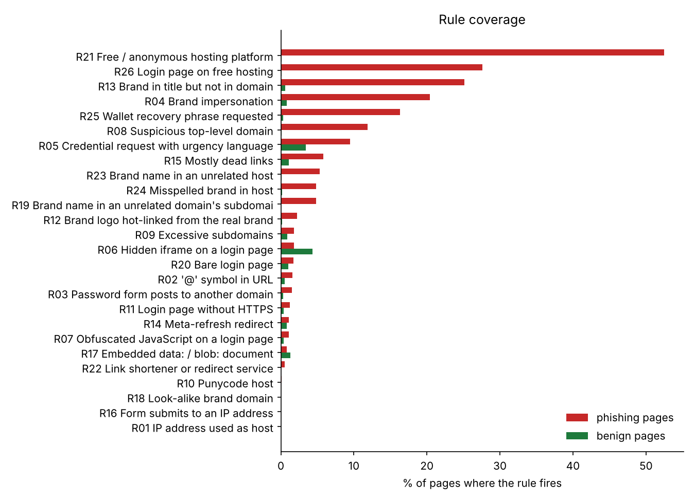
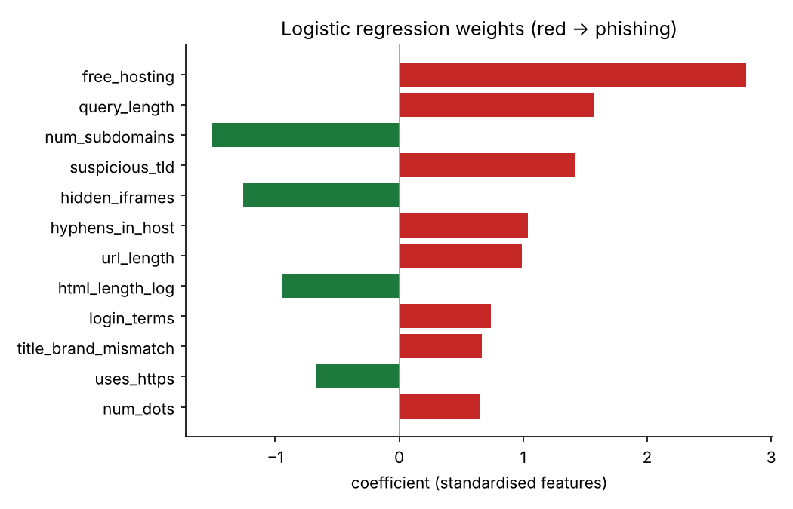

# Evaluation report — PhreshPhish-2000

Generated 2026-11-15T12:22:43+00:00 · features `features-2.1` · rules `rules-2.1` · served model `rf-20261115122243`

Dataset: **2000 pages** (1000 phishing, 1000 benign); stratified split 1400 train / 600 test (seed 42).

## T1–T3: precision, recall, F1 (held-out test set)

| Method | Precision | Recall | F1 | Accuracy | FPR | ROC-AUC | TP | FP | FN | TN |
|---|---|---|---|---|---|---|---|---|---|---|
| rules_only@0.40 | 0.883 | 0.327 | 0.477 | 0.642 | 0.043 | 0.810 | 98 | 13 | 202 | 287 |
| logistic_regression@0.5 | 0.940 | 0.830 | 0.881 | 0.888 | 0.053 | 0.948 | 249 | 16 | 51 | 284 |
| random_forest@0.5 | 0.944 | 0.890 | 0.916 | 0.918 | 0.053 | 0.976 | 267 | 16 | 33 | 284 |
| hybrid_untuned@0.40 (LR, w=0.6) | 0.960 | 0.807 | 0.877 | 0.887 | 0.033 | 0.952 | 242 | 10 | 58 | 290 |
| served@suspicious | 0.942 | 0.913 | 0.927 | 0.928 | 0.057 | 0.978 | 274 | 17 | 26 | 283 |
| served@phishing | 0.980 | 0.810 | 0.887 | 0.897 | 0.017 | 0.978 | 243 | 5 | 57 | 295 |

**Served configuration** (chosen by 5-fold cross-validation on the training split only — the test split was not used for any choice): model `random_forest` (logistic_regression: OOF F1 0.91, AUC 0.9738, random_forest: OOF F1 0.9324, AUC 0.9834); score = 0.7 × ML + 0.3 × rules; suspicious ≥ 0.36, phishing ≥ 0.48 (phishing threshold set for ≤ 2% false positives on training folds).

`served@suspicious` = page flagged as suspicious or phishing (the analyst queue); `served@phishing` = high-confidence phishing only. `hybrid_untuned` = the hand-set starter config (LR, weight 0.6, threshold 0.4) for comparison. FPR = false-positive rate on benign pages.

## T4: false-positive analysis

Served configuration at the suspicious threshold: **17 false positives**, **26 false negatives** on the test set. Every error is listed in `errors.csv` with the rules that fired and the model's top contributing features.

Rules present in false positives: R05 ×2, R20 ×2, R11 ×2, R21 ×1, R26 ×1, R15 ×1, R06 ×1, R13 ×1, R09 ×1

## Rule coverage (whole dataset)

| Rule | Weight | Fires on phishing | Fires on benign | Precision |
|---|---|---|---|---|
| R01 IP address used as host | 0.45 | 0.0% | 0.0% | — |
| R02 '@' symbol in URL | 0.35 | 1.6% | 0.5% | 0.762 |
| R03 Password form posts to another domain | 0.6 | 1.5% | 0.3% | 0.833 |
| R04 Brand impersonation | 0.5 | 20.4% | 0.8% | 0.962 |
| R05 Credential request with urgency language | 0.4 | 9.5% | 3.4% | 0.736 |
| R06 Hidden iframe on a login page | 0.25 | 1.8% | 4.3% | 0.295 |
| R07 Obfuscated JavaScript on a login page | 0.25 | 1.1% | 0.4% | 0.733 |
| R08 Suspicious top-level domain | 0.2 | 11.9% | 0.1% | 0.992 |
| R09 Excessive subdomains | 0.2 | 1.8% | 0.9% | 0.667 |
| R10 Punycode host | 0.35 | 0.1% | 0.0% | 1.0 |
| R11 Login page without HTTPS | 0.25 | 1.2% | 0.4% | 0.75 |
| R12 Brand logo hot-linked from the real brand | 0.35 | 2.2% | 0.2% | 0.917 |
| R13 Brand in title but not in domain | 0.25 | 25.1% | 0.6% | 0.977 |
| R14 Meta-refresh redirect | 0.15 | 1.1% | 0.8% | 0.579 |
| R15 Mostly dead links | 0.15 | 5.8% | 1.1% | 0.841 |
| R16 Form submits to an IP address | 0.45 | 0.0% | 0.0% | — |
| R17 Embedded data: / blob: document | 0.3 | 0.8% | 1.3% | 0.381 |
| R18 Look-alike brand domain | 0.5 | 0.0% | 0.0% | — |
| R19 Brand name in an unrelated domain's subdomain | 0.45 | 4.8% | 0.0% | 1.0 |
| R20 Bare login page | 0.2 | 1.7% | 1.0% | 0.63 |
| R21 Free / anonymous hosting platform | 0.2 | 52.5% | 0.1% | 0.998 |
| R22 Link shortener or redirect service | 0.3 | 0.5% | 0.0% | 1.0 |
| R23 Brand name in an unrelated host | 0.5 | 5.3% | 0.1% | 0.981 |
| R24 Misspelled brand in host | 0.5 | 4.8% | 0.2% | 0.96 |
| R25 Wallet recovery phrase requested | 0.6 | 16.3% | 0.3% | 0.982 |
| R26 Login page on free hosting | 0.4 | 27.6% | 0.1% | 0.996 |

## Decision latency

Full pipeline (parse → features → rules → model → decision) on 300 test pages: mean **88.19 ms**, median 61.54 ms, p95 249.03 ms, max 679.43 ms.

## Most influential features

| Logistic regression | coef | Random forest | importance |
|---|---|---|---|
| free_hosting | 2.798 | path_depth | 0.1001 |
| query_length | 1.568 | free_hosting | 0.0977 |
| num_subdomains | -1.507 | num_links | 0.0858 |
| suspicious_tld | 1.416 | html_length_log | 0.0802 |
| hidden_iframes | -1.26 | num_scripts | 0.0609 |
| hyphens_in_host | 1.037 | text_length_log | 0.0609 |
| url_length | 0.987 | url_length | 0.0507 |
| html_length_log | -0.949 | hidden_iframes | 0.0419 |
| login_terms | 0.737 | external_link_ratio | 0.0392 |
| title_brand_mismatch | 0.669 | external_resource_ratio | 0.0387 |
| uses_https | -0.668 | host_entropy | 0.0338 |
| num_dots | 0.657 | hidden_elements | 0.0248 |
